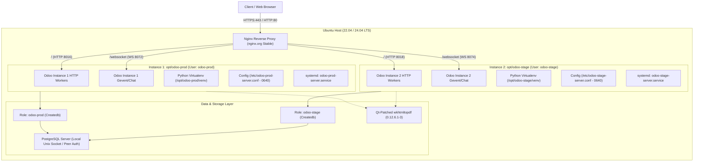

# Hardened Odoo Multi-Instance Installer

A modular, reliable Bash-based deployment tool for provisioning isolated Odoo application instances alongside an automated Nginx reverse proxy on Ubuntu LTS servers.

Each instance runs in its own dedicated Linux service account, isolated Python virtual environment, non-superuser PostgreSQL role, separate network port bindings, independent systemd daemon with Linux kernel sandboxing, and dedicated Nginx upstream configuration.

---

## 1. Problem Solved

Deploying multiple Odoo instances (e.g., development, staging, production, or multi-tenant customer environments) on a single physical or virtual host frequently leads to:
- **Port and process collisions**: Conflicts on default ports (`8069`, `8072`).
- **Dependency hell**: Conflicts between differing Python package requirements or Odoo versions.
- **Privilege escalation risks**: Shared Unix accounts or root-owned application directories.
- **Cross-instance database exposure**: Default Odoo settings exposing all databases across all instances via `/web/database/manager`.
- **Reporting breakage**: Flawed PDF generation and broken Arabic/RTL text rendering caused by unpatched distribution `wkhtmltopdf` binaries.

This repository provides an automated, auditable, two-phase installer that isolates each instance while keeping maintenance straightforward.

---

## 2. Technical Architecture



---

## 3. Supported Versions & Compatibility Matrix

Compatibility claims are evidence-based and verified against official Odoo runtime requirements (`odoo/release.py` and `requirements.txt`):

| Odoo Version | Minimum Python | Minimum PostgreSQL | Ubuntu 22.04 LTS (Jammy) | Ubuntu 24.04 LTS (Noble) | Notes |
|:---:|:---:|:---:|:---:|:---:|:---|
| **Odoo 16.0** | 3.7 | 12 | **Supported** (Python 3.10) | **Supported** (Python 3.12) | Requires `/longpolling` & `/websocket` routing. |
| **Odoo 17.0** | 3.10 | 12 | **Supported** (Python 3.10) | **Supported** (Python 3.12) | Default tested version. Native WebSocket bus. |
| **Odoo 18.0** | 3.10 | 12 | **Supported** (Python 3.10) | **Supported** (Python 3.12) | Upstream compatibility verified. |
| **Odoo 19.0** | 3.10 | 13 | **Supported** (Python 3.10) | **Supported** (Python 3.12) | Verified against branch `19.0` release constraints. |
| **Odoo 20.0** | 3.12 | 16 | **Explicitly Blocked** | **Supported** (Python 3.12) | Ubuntu 22.04 supplies Python 3.10 / PG 14; blocked at preflight. |

---

## 4. Key Engineering Features

- **Preflight Gating & Zero-Side-Effect Validation**: Rigorous checks run before any user, package, or directory is created. Refuses duplicate ports, existing Unix accounts, active port listeners, and incompatible OS/Odoo combinations.
- **Arabic / RTL PDF Reporting Integrity**: Automatically provisions the official Qt-patched `wkhtmltopdf` package (`0.12.6.1-3`) verified against pinned SHA-256 cryptographic checksums, resolving the regression where Arabic letters render disconnected or reversed.
- **Linux Service Sandboxing**: Systemd services run with `NoNewPrivileges=true`, `ProtectSystem=full`, `ProtectHome=true`, `PrivateTmp=true`, `PrivateDevices=true`, `ProtectKernelTunables=true`, `ProtectKernelModules=true`, `ProtectControlGroups=true`, and strict socket family restrictions.
- **Config Permission Hardening**: `/etc/<instance>.conf` is owned by `root:<instance>` with mode `0640`. The Odoo web worker cannot modify its own configuration file if compromised.
- **Independent Nginx Reverse Proxy & Logging**: Each instance writes its own Nginx configuration in `/etc/nginx/conf.d/` with isolated upstream blocks and dedicated log files rotated daily (30-day retention).
- **Safe Failure Trap**: Traps mid-execution errors and outputs the exact manual commands to clean up only the failed instance without touching neighboring instances.

---

## 5. Security Architecture & Limitations

### Implemented Hardening
1. **Service Accounts**: Service accounts are created with `--shell=/usr/sbin/nologin --no-create-home` to prevent interactive shell access.
2. **PostgreSQL Role Isolation**: Dedicated local role with `--createdb --no-superuser --no-createrole`. Uses PostgreSQL peer authentication over local Unix domain sockets; no TCP database ports are exposed externally.
3. **Loopback Binding**: Odoo binds exclusively to `127.0.0.1`. All external access is mediated by Nginx.
4. **Cookie Protection**: Cookie security flags (`secure`, `samesite=lax`) are decoupled from plain HTTP to prevent session lockouts on non-SSL setups, and enforced when SSL is active.

### Operational Limitations & Required Post-Installation Steps
- **Database Manager Exposure**: Odoo requires `list_db = True` during initial provisioning so that the administrator can initialize the first database through the web UI.
- **Post-Provisioning Action Required**: Once your database is created, you **must** configure database isolation:
  ```ini
  # In /etc/<instance>-server.conf:
  db_name = my_database
  dbfilter = ^my_database$
  list_db = False
  ```
  Then restart the service: `sudo systemctl restart <instance>-server.service`.

---

## 6. Installation & Deployment Guide

### Step 1: Prepare the Server (Run Once Per Host)

Run `server_config.sh` on a fresh or reviewed Ubuntu 22.04 or 24.04 LTS host. This script installs base build dependencies, PostgreSQL, official Nginx stable from `nginx.org`, Certbot, and the Qt-patched `wkhtmltopdf` binary.

```bash
# Clone the repository
git clone https://github.com/ameerweb/odoo-install.git
cd odoo-install

# Run server preparation
sudo bash server_config.sh
```

### Step 2: Deploy an Odoo Instance

Open `odoo_install.sh` and configure the instance variables at the top of the file:

```bash
OE_USER="odoo17"               # Unique system user and instance name
OE_PORT="8016"                 # Unique HTTP port (1024-65535)
LONGPOLLING_PORT="8072"        # Unique WebSocket port (1024-65535)
OE_VERSION="17.0"              # Odoo version
WEBSITE_NAME="erp.example.com" # FQDN domain name (or "_" for IP-only test)
ENABLE_SSL="True"              # Set to True for Let's Encrypt SSL
ADMIN_EMAIL="admin@example.com"# Real email address for Certbot
```

Deploy the instance:

```bash
sudo bash odoo_install.sh
```

---

## 7. Multi-Instance Deployment Example

To deploy two coexisting instances (`odoo-prod` on Odoo 17 and `odoo-stage` on Odoo 16):

### Instance 1: Production (Odoo 17)
Edit `odoo_install.sh`:
```bash
OE_USER="odoo-prod"
OE_PORT="8016"
LONGPOLLING_PORT="8072"
OE_VERSION="17.0"
WEBSITE_NAME="erp.mycompany.com"
ENABLE_SSL="True"
ADMIN_EMAIL="ops@mycompany.com"
```
Run `sudo bash odoo_install.sh`.

### Instance 2: Staging (Odoo 16)
Edit `odoo_install.sh`:
```bash
OE_USER="odoo-stage"
OE_PORT="8018"
LONGPOLLING_PORT="8074"
OE_VERSION="16.0"
WEBSITE_NAME="stage.mycompany.com"
ENABLE_SSL="True"
ADMIN_EMAIL="ops@mycompany.com"
```
Run `sudo bash odoo_install.sh`.

Both instances run simultaneously without port, filesystem, or database collisions.

---

## 8. Operational Verification Commands

Verify the status of your host and deployed instances with standard Linux diagnostics:

```bash
# Check Odoo daemon status and recent journal logs
sudo systemctl status <instance>-server.service
sudo journalctl -u <instance>-server.service -n 50 --no-pager

# Verify local listening ports
sudo ss -ltnp '( sport = :8016 or sport = :8072 )'

# Test Nginx reverse proxy configuration and reload
sudo nginx -t
sudo systemctl reload nginx

# Verify Qt-patched wkhtmltopdf version
wkhtmltopdf --version

# Test logrotate configuration syntax
sudo logrotate --debug /etc/logrotate.d/<instance>-server
```

---

## 9. Troubleshooting

| Symptom | Cause | Solution |
|:---|:---|:---|
| `An Odoo port is already in use` | `OE_PORT` or `LONGPOLLING_PORT` is occupied | Check listening ports with `ss -ltnp` and assign unassigned ports. |
| `Odoo 20.0 requires Python >= 3.12` | Ubuntu 22.04 LTS defaults to Python 3.10 | Deploy Odoo 20 on Ubuntu 24.04 LTS or use Odoo 16–19 on Ubuntu 22.04. |
| Arabic PDF reports print disjointed letters | Unpatched `wkhtmltopdf` binary installed | Run `server_config.sh` to install the official Qt-patched deb (`0.12.6.1-3`). |
| Certbot certificate generation fails | `WEBSITE_NAME` does not resolve to the server IP | Ensure public DNS A records point to your server before enabling SSL. |
| `proxy_cookie_flags` login failure | `secure` flag enforced over HTTP | Ensure SSL is provisioned or disable SSL cookie flags on plaintext HTTP. |

---

## 10. Automated Testing & CI

This repository includes an automated test suite located in `tests/`:

- `test_syntax.sh`: Validates shell script syntax via `bash -n`.
- `test_shellcheck.sh`: Runs static analysis with `shellcheck -x` enforcing zero warnings.
- `test_preflight_validation.sh`: Verifies input validation, reserved user rejection, port collision rejection, and version compatibility gates.
- `test_config_generation.sh`: Validates generated configuration files, systemd sandboxing directives, and Nginx site structures.
- `test_multi_instance_isolation.sh`: Verifies zero port or namespace overlaps between coexisting instances.
- `run_tests.sh`: Master test runner.

Run the test suite locally:
```bash
bash tests/run_tests.sh
```

GitHub Actions executes this test suite across Ubuntu 22.04 and Ubuntu 24.04 runners on every push and pull request.

---

## 11. Upstream Attribution & Contributions

This repository was adapted from the original `InstallScript` by [Yenthe Van Ginneken](https://github.com/Yenthe666/InstallScript) (licensed under MIT).

### Key Architectural Enhancements in this Repository:
1. **Decoupled Architecture**: Split host setup (`server_config.sh`) from instance provisioning (`odoo_install.sh`).
2. **True Multi-Instance Isolation**: Added dedicated non-login service accounts, individual virtualenvs, independent systemd units, separate ports, and instance-specific Nginx configs.
3. **Arabic & RTL PDF Patch**: Fixed report generation regressions by pinning verified Qt-patched `wkhtmltopdf` packages and font dependencies.
4. **Security Hardening**: Implemented systemd Linux sandboxing, `0640 root:<user>` config permissions, and safe cookie handling.
5. **Preflight Gating & Automated Testing**: Added input validation, version compatibility gating, and a comprehensive automated test suite.

---

## 12. Repository Metadata Recommendations

- **Repository Description**:
  > Modular, hardened Bash installer for isolated multi-instance Odoo deployments with Nginx reverse proxy, Qt-patched wkhtmltopdf, and systemd sandboxing on Ubuntu LTS.
- **Suggested Topics**:
  `odoo`, `devops`, `bash`, `nginx`, `postgresql`, `multi-instance`, `sysadmin`, `ubuntu`, `systemd`, `wkhtmltopdf`, `hardened`, `automation`
